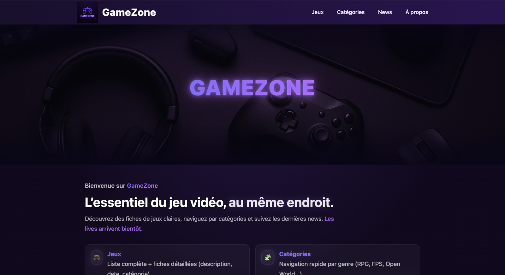
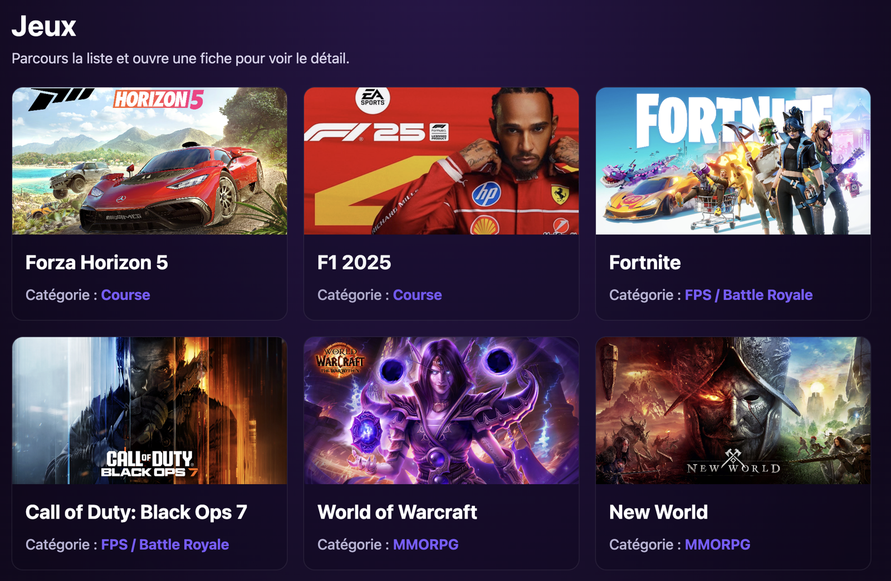

# GameZone – Frontend (Angular)

Interface web de **GameZone**, une plateforme dédiée à l'univers du jeu vidéo : sélection de jeux, navigation par catégories, actualités. Elle consomme l'API Symfony du dépôt [gamezone-backend](https://github.com/Yoann04/gamezone-backend).

Projet de formation (dossier professionnel Studi – Développeur Web et Web Mobile). **Statut : terminé** pour son périmètre (consultation). Il se lance en local (voir plus bas).

## Aperçu

| Accueil | Liste des jeux |
|---|---|
|  |  |

## Pages

| Route | Contenu |
|---|---|
| `/` | Accueil |
| `/games`, `/games/:slug` | Liste des jeux, fiche détaillée d'un jeu |
| `/categories`, `/categories/:slug` | Catégories, jeux d'une catégorie |
| `/news`, `/news/:slug` | Actualités, détail d'une actualité (liées à un jeu) |
| `/about` | À propos |

Une page « Lives » (streams liés à un jeu) existe dans le code mais **n'est pas finalisée** : l'accueil l'annonce « bientôt disponible ».

## Stack

- Angular 20 (composants standalone, routing), TypeScript 5.9
- SCSS
- `HttpClient` + services typés (`GameService`, `CategoryService`, `NewsService`)
- API REST Symfony 6.4 / MySQL (autre dépôt)

## Lancer en local

1. Démarrer l'API : suivre le README de [gamezone-backend](https://github.com/Yoann04/gamezone-backend) (par défaut sur `http://127.0.0.1:8000`).
2. Puis :

```bash
npm install
npx ng serve        # http://localhost:4200
```

Prérequis : Node.js 18+ (Angular 20 recommande une version LTS récente), Angular CLI.

> L'URL de l'API (`http://127.0.0.1:8000/api/...`) est écrite en dur dans `src/app/services/`. Pour un déploiement, elle devrait passer en variable d'environnement.

## Limites connues

- Consultation uniquement : pas de comptes ni de back-office
- URL de l'API en dur, pas de rendu serveur (SSR), tests unitaires minimaux
- Page Lives incomplète
